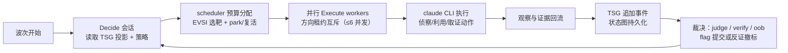

# hxctf — 自主安全交战引擎

**简体中文** · [English](README_EN.md)

LLM 驱动的自主安全交战引擎：给定凭据与目标，自动完成场景判形、侦察、漏洞利用、取证与提交，全程无人工旋钮。同一内核支持五种交战形态——平台基准解题（TsecBench/HXCTF）、实战漏洞挖掘（finding-live）、白盒代码审计（finding-source）、KOH 攻防、第三方赛道资产收集。交付物为单文件从 0 构建的 Docker 镜像（约 11GB 未压缩），可再压成 <3GB 云托管包。

> 本 README 所有命令均在 Docker 29.x + 真实镜像上实测通过（增量构建 82s、托管清理 13.7GB→7.0GB、五条入口链路全通）。

## 架构图

整体分层（从入口到裁决的完整链路）：

```mermaid
flowchart TB
    subgraph ENTRY["入口层 · solver/"]
        RUN["run.sh（ENTRYPOINT）<br/>VPN 连接 + egress 策略 + 分发"]
        AUTO["autoroute.py<br/>场景自动判形"]
        RUN --> AUTO
    end

    subgraph DRIVERS["场景驱动层"]
        RB["run_bench.py<br/>TsecBench 基准解题"]
        RF["run_finding.py<br/>finding-live 渗透挖掘"]
        RS["run_source.py<br/>finding-source 白盒审计"]
        RK["run_koh.py<br/>KOH 攻防"]
        SOLVE["solve.py / bench.py<br/>裸解题器 / 裸跑分"]
    end

    subgraph CORE["引擎核心 · Decide/Execute 波次"]
        LOOP["loop.py<br/>主循环（波次编排）"]
        DECIDE["decide.py + prompts.py<br/>规划会话与动作行解析"]
        SCHED["scheduler.py<br/>全局时间预算 + EVSI + 复活调度"]
        SUB["subgoal.py<br/>持久子目标 + foothold 固化 + 租约"]
        POL["policy.py<br/>EXECUTE 情境策略注入"]
        TSG["tsg/store.py<br/>事件溯源类型化状态图"]
        FOLD["fold.py + pacing.py<br/>上下文折叠 + 时长无关化"]
        SREC["shared_recon.py<br/>跨题只读侦察共享（top-16 封顶）"]
        LEASE["intent_lease.py<br/>并行波方向互斥租约"]
        INV["invariants.py + classify.py<br/>运行时不变量 + 正则分类器"]
    end

    subgraph EXEC["执行层"]
        CC["cc.py<br/>Claude Code 运行器核（daemon drain + 硬墙钟）"]
        CLI["claude CLI 子进程<br/>（降权 uid 执行）"]
        PROV["providers.py<br/>角色模型接入 + egress 网关改写"]
        TB["timebox.py<br/>外部调用硬超时原语"]
    end

    subgraph KNOW["知识层"]
        KB["kb_search.py<br/>/opt/kb 检索中间件<br/>nuclei ~4400 模板 · MSF ~4000 模块<br/>Exploit-DB · 默认口令索引"]
        VULN["vulnrag.py<br/>Vul-RAG 七元素 + BM25/RRF"]
        EKB["ekb.py + expsearch.py<br/>交战情报库 + 漏洞事实检索"]
        AMMO["ammo.py + riskdata.py<br/>弹药管线 + KEV/EPSS 快照"]
    end

    subgraph JUDGE["裁决层"]
        JUD["judge.py<br/>达成判定"]
        VER["verify.py<br/>L1 执行反证"]
        OOB["oob.py<br/>带外回调监听"]
        ADJ["adjudicate.py + seqtest.py<br/>无 flag 裁决 + 序贯检验"]
        ORA["effect_oracle / logic_oracle<br/>效果与业务逻辑判据"]
    end

    subgraph WHITEBOX["白盒线（finding-source）"]
        SRC["source_pipeline.py<br/>C 线发现流水线"]
        SEM["semgrep_runner.py + checker.py<br/>合成规则 + CVE 回放闸门"]
        BAY["bayesearch.py<br/>次模读码 + 贝叶斯选靶"]
    end

    AUTO --> RB & RF & RS & RK & SOLVE
    RB & RF & RS & RK & SOLVE --> LOOP
    LOOP --> DECIDE & SCHED & SUB & POL & TSG & FOLD & SREC & LEASE & INV
    LOOP --> CC
    CC --> CLI
    CC --> PROV
    LOOP --> TB
    CC & LOOP --> KB & VULN & EKB & AMMO
    LOOP --> JUD & VER & OOB & ADJ & ORA
    RS --> SRC & SEM & BAY
```



单次波次循环（Decide 规划 → 并行 Execute → 证据回流 → 裁决收敛）：



## 核心机制

- **波次循环**：引擎以 Decide/Execute 波次推进。Decide 会话依据 TSG（事件溯源状态图）的当前投影规划下一步；Execute 以最多 6 个并行 worker 执行，方向租约（intent_lease）保证互斥与不重复；结果回写 TSG 后进入下一波。
- **全局调度**：scheduler 按 EVSI 思想分配时间预算，可 park 低价值目标并在条件变化后复活；复活健壮性处理软杀/硬杀会话（清 `_session_id` 重建，避免死会话连锁失败）。
- **持久记忆**：TSG 事件溯源状态图 + EKB 交战情报库 + 持久子目标与 foothold 固化 + Vul-RAG 知识飞轮，跨波次、跨题目累积。
- **知识前置**：kb_search 把镜像内的 nuclei 模板、MSF 模块、Exploit-DB、默认口令库统一索引，按组件/CVE 映射进规划上下文，配额受控、只投喂元数据。
- **裁决三闸**：judge 达成判定、verify L1 执行反证、oob 带外回调，配合序贯检验与效果/逻辑 oracle，防误报落账。
- **时长无关化**：pacing 让上下文构造与总时长解耦，短时与长时任务使用同一套进展口径。
- **多模型角色**：五个角色（decide / execute / execute_high / judge / small）各自可配 `provider:model@base_url`，默认主力模型 + 跨厂商容灾轮转；Anthropic↔OpenAI 协议桥适配任意网关。
- **出口数据化**：模型流量经 profiles 数据文件（如 `tsecbench.json`）改写网关，引擎代码零平台特调字面量；运行出口策略默认 open，可选 locked（fail-closed）。

## 目录结构

```
.
├── Dockerfile.all            # 单文件从 0 完整构建（工具链 → 引擎 → 知识库 → 硬化）
├── Dockerfile.engine         # 增量层：把最新 engine/ 叠进已有基镜像
├── build_image.py            # 从 0 构建入口（代理可选、上下文自检、缓存友好）
├── build_engine_incremental.py  # 增量构建入口（自动冻结 base、防层数累积）
├── slim_image.py             # Windows 原生托管包压缩（<3GB tar.gz + sha256）
├── slimify_hosted.sh         # bash 版托管包压缩（含角色模型交互注入 + sha256）
├── launch_bench.sh           # 平台基准一键启动（VPN + 引擎回路 + 日志留存）
├── track3_hunt.sh            # 第三赛道一键：FOFA 资产 → finding-live 挖掘
├── make_bundle.py            # 代码分发包打包工具
├── engine/                   # 引擎（51 个非测试模块）
│   ├── tsg/                  # 事件溯源状态图
│   ├── repro/                # 复现 oracle（diff / docker）
│   └── profiles/             # 出口数据文件（tsecbench.json 等）
├── solver/                   # 入口与驱动（run.sh / autoroute / 各场景 runner）
└── kb-extra/                 # 随仓库分发的知识页（crypto / lang-jails / web-logic 等）
```

## 从 0 构建（完整编译）

只需 Docker 与网络；语料（vulhub、SecLists、PayloadsAllTheThings、MSF 模块、nuclei 模板、ghidra 等）在构建期从 github / gh-proxy 回退 / 国内镜像自动拉取，仓库内零大文件。

```bash
# 方式一：脚本（自动自检 docker、上下文、代理可达性）
python3 build_image.py                # 默认经本地代理 host.docker.internal:7897
python3 build_image.py --no-proxy     # 本机可直连 github 时
python3 build_image.py --proxy-port 7890   # 自定义代理端口

# 方式二：手动（等价命令；已通过 docker build --check 校验零警告）
docker build -f Dockerfile.all -t hxctf:v1 .
# 墙内机器建议带代理 build-arg（四个都要）：
#   --build-arg HTTP_PROXY=http://host.docker.internal:7897 \
#   --build-arg HTTPS_PROXY=http://host.docker.internal:7897 \
#   --build-arg http_proxy=http://host.docker.internal:7897 \
#   --build-arg https_proxy=http://host.docker.internal:7897
```

- 首次构建需要数十分钟到一小时以上，取决于网络；apt/pip 均已配置国内镜像主备回退，代理为可选项。
- 构建上下文由 `.dockerignore` 裁剪（engine 测试文件与缓存自动排除），请保持该文件在构建目录。
- 产物 `hxctf:v1` 已内建出口 ENV，无任何密钥 bake，运行时注入即可。
- 大语料可选纳入：`--marcio`（+~1.2GB）/ `--trickest`（+~1GB）。

## 增量构建（只改了引擎代码时）

已实测：对既有 `hxctf:base` 基底叠加本仓库 engine/，82 秒完成（含全量 compileall 与 import 自检）。

```bash
python3 build_engine_incremental.py          # 叠到 hxctf:v1（首次自动从 v1 冻结 hxctf:base）
python3 build_engine_incremental.py --tag hxctf:v1-verify   # 打到测试 tag 验证，不动 v1
```

## 出云托管包（<3GB tar.gz）

已实测（DRYRUN）：清理链把未压缩 13704MB 压到 7005MB，gzip 后约 3.2GB 边界，超限时按提示加 AGGRESSIVE。

```bash
python3 slim_image.py --no-prompt   # Windows 原生（只需 Docker Desktop + Python）
bash slimify_hosted.sh              # macOS / WSL / Git-Bash（TTY 下交互注入角色模型）

# 先估算不导出（轻量验证）：
DRYRUN=1 NO_PROMPT=1 bash slimify_hosted.sh
python3 slim_image.py --dryrun --no-prompt
```

压缩脚本会：清理镜像内冗余（文档/缓存/benchmark 用不到的重工具，核心能力哨兵全检）→ export|import 扁平化 → gzip -9 → **写入随机构建指纹 `/app/.build_nonce` 并计算落盘 sha256**（同一份代码两次打包哈希必不相同），末尾打印 sha256 并生成 `<产物>.tar.gz.sha256` 指纹文件。bash 版交互模式可把角色→模型映射（`HXCTF_MODEL_DECIDE` 等）作为 ENV 写入镜像。

## 运行

入口为 `/app/solver/run.sh`：默认自动判形（autoroute）；显式子命令直达场景；以 `-` 开头的旗标走裸解题器。以下均在真实镜像上实测：

```bash
# 裸解题器（usage 实测输出：python3 -m solver.solve --target ... --task ...）
docker run --rm -e SOLVER_API_KEY=sk-... hxctf:v1 \
  --target http://<ip>:80 --task "题目描述"

# 自动判形（实测输出：[autoroute] 判形 → finding-live (targets=0)，随后提示设置 API key）
docker run --rm -e SOLVER_API_KEY=sk-... hxctf:v1 --target ... --task ...

# 平台基准（前置检查 BENCHMARK_TOKEN / BENCHMARK_BASE_URL，缺省即退出）
docker run --rm -e SOLVER_API_KEY=sk-... \
  -e BENCHMARK_TOKEN=... -e BENCHMARK_BASE_URL=... \
  hxctf:v1 bench-engine

# 其余场景子命令：finding-live | finding-source | koh | auto | bench
docker run --rm -e SOLVER_API_KEY=sk-... hxctf:v1 koh --help

# 宿主一键：VPN + 基准回路 + 日志留存
export BENCHMARK_TOKEN=... BENCHMARK_BASE_URL=...
./launch_bench.sh <path/to.ovpn> [题号...]

# 第三赛道一键：FOFA 资产收集 → finding-live 全目标挖掘
FOFA_KEY=... DKEY=... ./track3_hunt.sh
```

关键环境变量：

| 变量 | 作用 |
|---|---|
| `SOLVER_API_KEY` | 模型网关密钥（运行时注入，镜像内无密钥；通用回退 `HXCTF_LLM_API_KEY`） |
| `HXCTF_MODEL_{DECIDE,EXECUTE,EXECUTE_HIGH,JUDGE,SMALL}` | 角色模型覆盖，格式 `provider:model@base_url`，留空走默认 + 容灾轮转 |
| `BENCHMARK_TOKEN` / `BENCHMARK_BASE_URL` | 平台基准凭据（bench-engine 与 launch_bench.sh 必需） |
| `HXBAI_VPN_CONFIG` | 可选 OpenVPN 配置挂载路径；请求了 VPN 但隧道未确认 up 时 fail-closed 拒绝起跑 |
| `HXCTF_EGRESS` | 运行出口策略，默认 `open`（实测启动日志 `[egress] OPEN`）；`locked` 需 iptables + NET_ADMIN，封不住即拒绝起跑 |
| `HXCTF_LLM_EGRESS` | 模型出口 profile（镜像默认 `tsecbench` 网关改写，数据文件驱动） |

## 协作

直推 main 或开分支走 PR 均可（机器人 nwpubot 会自动扫描并在直推 commit 下贴变更报告）。提交信息用一句话说清改动；仓库内代码为去注释版，请勿回填大段注释。

## Star 历史

[](https://star-history.com/#inwpu/hxbai&Date)
