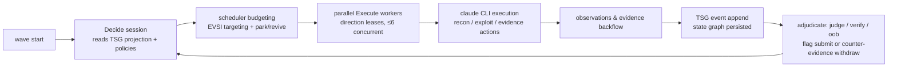

# hxctf — Autonomous Security Engagement Engine

[简体中文](README.md) · **English**

An LLM-driven autonomous security engagement engine: given credentials and a target, it detects the engagement scenario, performs reconnaissance, exploitation, evidence capture and submission on its own, with zero human-tunable knobs. One kernel powers five engagement modes — platform benchmark solving (TsecBench/HXCTF), live vulnerability hunting (finding-live), white-box code audit (finding-source), KOH attack-and-defense, and third-track asset collection. The deliverable is a single-file from-scratch Docker image (~11GB uncompressed) that can be further compressed into a <3GB cloud-hosted package.

> Every command in this README was verified on Docker 29.x with a real image (incremental build in 82s, hosted cleanup 13.7GB→7.0GB, all five entry chains dispatch correctly).

## Architecture

Layered view, entry to adjudication:

```mermaid
flowchart TB
    subgraph ENTRY["Entry · solver/"]
        RUN["run.sh (ENTRYPOINT)<br/>VPN + egress policy + dispatch"]
        AUTO["autoroute.py<br/>scenario auto-detection"]
        RUN --> AUTO
    end

    subgraph DRIVERS["Scenario drivers"]
        RB["run_bench.py<br/>TsecBench benchmark"]
        RF["run_finding.py<br/>finding-live hunting"]
        RS["run_source.py<br/>finding-source audit"]
        RK["run_koh.py<br/>KOH attack-defense"]
        SOLVE["solve.py / bench.py<br/>bare solver / bare bench"]
    end

    subgraph CORE["Engine core · Decide/Execute waves"]
        LOOP["loop.py<br/>main wave loop"]
        DECIDE["decide.py + prompts.py<br/>planning session & action parsing"]
        SCHED["scheduler.py<br/>global time budget + EVSI + revival"]
        SUB["subgoal.py<br/>persistent subgoals + foothold + leases"]
        POL["policy.py<br/>EXECUTE contextual policies"]
        TSG["tsg/store.py<br/>event-sourced typed state graph"]
        FOLD["fold.py + pacing.py<br/>context folding + duration independence"]
        SREC["shared_recon.py<br/>cross-task recon sharing (top-16 cap)"]
        LEASE["intent_lease.py<br/>direction leases for parallel waves"]
        INV["invariants.py + classify.py<br/>runtime invariants + regex classifiers"]
    end

    subgraph EXEC["Execution layer"]
        CC["cc.py<br/>Claude Code runner core"]
        CLI["claude CLI subprocess<br/>(dropped-privilege uid)"]
        PROV["providers.py<br/>role models + egress gateway rewrite"]
        TB["timebox.py<br/>hard wall-clock timeout primitive"]
    end

    subgraph KNOW["Knowledge layer"]
        KB["kb_search.py<br/>/opt/kb retrieval middleware<br/>nuclei ~4400 templates · MSF ~4000 modules<br/>Exploit-DB · default-login index"]
        VULN["vulnrag.py<br/>Vul-RAG seven-element + BM25/RRF"]
        EKB["ekb.py + expsearch.py<br/>engagement KB + exploit facts"]
        AMMO["ammo.py + riskdata.py<br/>credential pipeline + KEV/EPSS"]
    end

    subgraph JUDGE["Adjudication layer"]
        JUD["judge.py<br/>achievement judging"]
        VER["verify.py<br/>L1 execution counter-evidence"]
        OOB["oob.py<br/>out-of-band callback listener"]
        ADJ["adjudicate.py + seqtest.py<br/>no-flag adjudication + sequential testing"]
        ORA["effect_oracle / logic_oracle<br/>effect & business-logic criteria"]
    end

    subgraph WHITEBOX["White-box line (finding-source)"]
        SRC["source_pipeline.py<br/>discovery pipeline"]
        SEM["semgrep_runner.py + checker.py<br/>synthesized rules + CVE replay gate"]
        BAY["bayesearch.py<br/>submodular reading + Bayesian targeting"]
    end

    AUTO --> RB & RF & RS & RK & SOLVE
    RB & RF & RS & RK & SOLVE --> LOOP
    LOOP --> DECIDE & SCHED & SUB & POL & TSG & FOLD & SREC & LEASE & INV
    LOOP --> CC
    CC --> CLI
    CC --> PROV
    LOOP --> TB
    CC & LOOP --> KB & VULN & EKB & AMMO
    LOOP --> JUD & VER & OOB & ADJ & ORA
    RS --> SRC & SEM & BAY
```



Single wave (plan → parallel execute → evidence backflow → adjudication):



## Key mechanisms

- **Wave loop**: the engine advances in Decide/Execute waves. The Decide session plans from the current TSG (event-sourced state graph) projection; Execute runs up to 6 parallel workers with mutual-exclusive direction leases; results append to the TSG before the next wave.
- **Global scheduling**: scheduler allocates time budget in an EVSI spirit, parks low-value targets and revives them when conditions change; revival hardening clears dead sessions after soft/hard kills.
- **Persistent memory**: TSG state graph, engagement KB (EKB), persistent subgoals with foothold consolidation, and a Vul-RAG knowledge flywheel accumulate across waves and tasks.
- **Knowledge prefetch**: kb_search uniformly indexes in-image nuclei templates, MSF modules, Exploit-DB and default-credential corpora, mapping components/CVEs into planning context under controlled quotas, metadata only.
- **Triple adjudication gate**: judge, verify (L1 execution counter-evidence) and oob (out-of-band callback), combined with sequential testing and effect/logic oracles to keep false positives out of the ledger.
- **Duration independence**: pacing decouples context construction from total run length, so short and long tasks share one progress vocabulary.
- **Multi-model roles**: five roles (decide / execute / execute_high / judge / small), each configurable as `provider:model@base_url`, defaulting to the primary model with cross-vendor failover rotation; an Anthropic↔OpenAI protocol bridge adapts any gateway.
- **Data-driven egress**: model traffic is rewritten via profile data files (e.g. `tsecbench.json`); the engine carries zero platform-specific literals. Runtime egress defaults to open; locked is opt-in and fail-closed.

## Directory layout

```
.
├── Dockerfile.all            # single-file from-scratch build (toolchain → engine → KB → hardening)
├── Dockerfile.engine         # incremental layer: overlay latest engine/ onto an existing base
├── build_image.py            # from-scratch build entry (optional proxy, context self-checks)
├── build_engine_incremental.py  # incremental build entry (auto-freezes base, caps layer count)
├── slim_image.py             # Windows-native hosted packaging (<3GB tar.gz + sha256)
├── slimify_hosted.sh         # bash hosted packaging (interactive role-model injection + sha256)
├── launch_bench.sh           # one-shot benchmark launcher (VPN + engine loop + log retention)
├── track3_hunt.sh            # third-track one-shot: FOFA assets → finding-live hunting
├── make_bundle.py            # code-distribution bundle packer
├── engine/                   # engine (51 non-test modules)
│   ├── tsg/                  # event-sourced state graph
│   ├── repro/                # reproduction oracles (diff / docker)
│   └── profiles/             # egress data files (tsecbench.json, …)
├── solver/                   # entry & drivers (run.sh / autoroute / scenario runners)
└── kb-extra/                 # knowledge pages shipped with the repo (crypto / lang-jails / web-logic …)
```

## Build from scratch

Only Docker and network access are required; corpora (vulhub, SecLists, PayloadsAllTheThings, MSF modules, nuclei templates, ghidra, …) are fetched at build time from github with gh-proxy fallback and CN package mirrors, so the repo stays free of large files.

```bash
# Option 1: helper script (self-checks docker, build context, proxy reachability)
python3 build_image.py                # via local proxy host.docker.internal:7897 by default
python3 build_image.py --no-proxy     # when the machine reaches github directly
python3 build_image.py --proxy-port 7890

# Option 2: manual equivalent (passes `docker build --check` with zero warnings)
docker build -f Dockerfile.all -t hxctf:v1 .
# Behind a restricted network, pass all four proxy build-args:
#   --build-arg HTTP_PROXY=http://host.docker.internal:7897 \
#   --build-arg HTTPS_PROXY=http://host.docker.internal:7897 \
#   --build-arg http_proxy=http://host.docker.internal:7897 \
#   --build-arg https_proxy=http://host.docker.internal:7897
```

- The first build takes tens of minutes to over an hour depending on network; apt/pip use CN mirrors with fallbacks, and the proxy is optional.
- `.dockerignore` trims the build context (engine test files and caches are excluded automatically); keep it next to the Dockerfile.
- The resulting `hxctf:v1` ships with egress ENV baked in and zero secrets; inject keys at runtime.
- Optional large corpora: `--marcio` (+~1.2GB) / `--trickest` (+~1GB).

## Incremental build (engine-code-only changes)

Verified: overlaying this repo's engine/ onto an existing `hxctf:base` completes in 82 seconds, including full compileall and import self-checks.

```bash
python3 build_engine_incremental.py          # onto hxctf:v1 (auto-freezes hxctf:base from v1 on first run)
python3 build_engine_incremental.py --tag hxctf:v1-verify   # build to a test tag, leaves v1 untouched
```

## Hosted package (<3GB tar.gz)

Verified (DRYRUN): the cleanup chain takes uncompressed size from 13704MB down to 7005MB; gzip lands near the 3.2GB boundary — add AGGRESSIVE levels if over.

```bash
python3 slim_image.py --no-prompt   # Windows native (Docker Desktop + Python only)
bash slimify_hosted.sh              # macOS / WSL / Git-Bash (interactive role-model injection on TTY)

# Estimate only, no export (lightweight verification):
DRYRUN=1 NO_PROMPT=1 bash slimify_hosted.sh
python3 slim_image.py --dryrun --no-prompt
```

The packager runs a cleanup pass inside the image (docs/caches/heavy tools the benchmark never uses, with capability sentinels guarding the core), flattens via export|import, gzips at level 9, **writes a random build nonce `/app/.build_nonce` and records the sha256** (two builds from identical code always yield different hashes), prints the digest and emits a `<artifact>.tar.gz.sha256` sidecar. The bash flavor can inject role→model mappings (`HXCTF_MODEL_DECIDE` etc.) as ENV into the image.

## Run

The entrypoint is `/app/solver/run.sh`: scenario auto-detection by default (autoroute); explicit subcommands go straight to a scenario; leading flags fall through to the bare solver. All of the following were verified against a real image:

```bash
# Bare solver (verified usage: python3 -m solver.solve --target ... --task ...)
docker run --rm -e SOLVER_API_KEY=sk-... hxctf:v1 \
  --target http://<ip>:80 --task "task description"

# Auto scenario detection (verified output: [autoroute] 判形 → finding-live, then an API-key prompt)
docker run --rm -e SOLVER_API_KEY=sk-... hxctf:v1 --target ... --task ...

# Platform benchmark (checks BENCHMARK_TOKEN / BENCHMARK_BASE_URL first and exits if missing)
docker run --rm -e SOLVER_API_KEY=sk-... \
  -e BENCHMARK_TOKEN=... -e BENCHMARK_BASE_URL=... \
  hxctf:v1 bench-engine

# Other scenario subcommands: finding-live | finding-source | koh | auto | bench
docker run --rm -e SOLVER_API_KEY=sk-... hxctf:v1 koh --help

# Host-side one-shot: VPN + benchmark loop + log retention
export BENCHMARK_TOKEN=... BENCHMARK_BASE_URL=...
./launch_bench.sh <path/to.ovpn> [task-ids...]

# Third-track one-shot: FOFA asset collection → finding-live hunting
FOFA_KEY=... DKEY=... ./track3_hunt.sh
```

Key environment variables:

| Variable | Purpose |
|---|---|
| `SOLVER_API_KEY` | model gateway key (injected at runtime; no secrets in the image; generic fallback `HXCTF_LLM_API_KEY`) |
| `HXCTF_MODEL_{DECIDE,EXECUTE,EXECUTE_HIGH,JUDGE,SMALL}` | per-role model override, format `provider:model@base_url`; empty = default + failover rotation |
| `BENCHMARK_TOKEN` / `BENCHMARK_BASE_URL` | platform credentials (required by bench-engine and launch_bench.sh) |
| `HXBAI_VPN_CONFIG` | optional OpenVPN config mount; fail-closed if the tunnel never confirms up |
| `HXCTF_EGRESS` | runtime egress policy, default `open` (verified boot log `[egress] OPEN`); `locked` requires iptables + NET_ADMIN and refuses to start if it cannot enforce |
| `HXCTF_LLM_EGRESS` | model egress profile (image default: `tsecbench` gateway rewrite, data-file driven) |

## Collaborating

Push to main directly or use a branch + PR (the nwpubot robot scans every push and posts a change report under direct-push commits). Keep commit messages to one descriptive line; the code in this repo is kept comment-stripped — please do not reintroduce large comment blocks.

## Star History

[](https://star-history.com/#inwpu/hxbai&Date)
